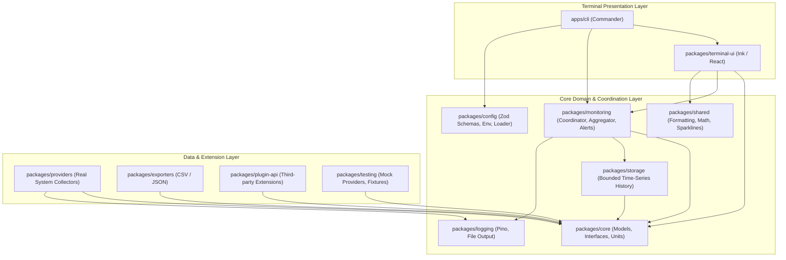

# TaskPulse Architecture

TaskPulse adopts clean architecture principles and a package-oriented modular structure.

## Key Architectural Principles

1. **Explicit Dependency Inversion**:
   The monitoring engine and UI interact solely with domain interfaces (`ICpuMonitor`, `IMemoryMonitor`, `IMetricHistory`, etc.) defined in `@taskpulse/core`. Concrete collectors in `@taskpulse/providers` implement these interfaces without bleeding operating-system dependencies into domain logic.

2. **Fault Isolation & Graceful Degradation**:
   Metric collection runs through the `CollectorPool`. Each provider is wrapped in an individual timeout and error boundary. A failure or timeout in one provider (e.g. an unavailable GPU sensor or protected hardware counter) will never terminate the application or prevent other collectors from updating.

3. **Monotonic Rate Calculations**:
   Disk I/O and network throughput are calculated using monotonic timestamps (`performance.now()`) and cumulative counter deltas, properly handling counter resets and interface additions.

4. **Decoupled Sampling from Terminal Redraw**:
   Metric sampling runs on a dedicated timer loop independent of React terminal component rendering. The UI subscribes to snapshot events and updates without unnecessary tree recreation.
